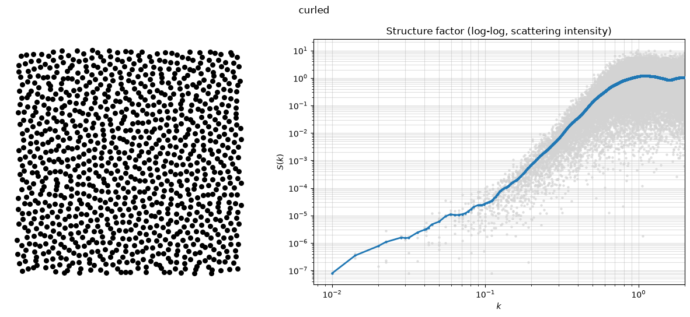

# structure-factor-v2

[](https://pypi.org/project/structure-factor-v2/)
[](https://github.com/adecacqueray/structure-factor-v2/blob/main/LICENSE)
[](https://github.com/adecacqueray/structure-factor-v2)

**Structure factor $S(k)$ of point sets in the unit cube $[0, 1)^D$**, with fast transforms (finufft / cufinufft), kaiser taper and ready-made log-log plots.

For a point set $(x_j)_{1 \le j \le N} \subset [0, 1)^D$, the structure factor or power spectrum
can be estimated using the scattering intensity:

```math
S(k) = \frac{1}{N} \left| \sum_{j=1}^{N} e^{-2i\pi \langle k, x_j \rangle} \right|^2,
\qquad k \in \mathbb{Z}^D \setminus \{0\}.
```

$S(k)$ measures density fluctuations in Fourier space. A pattern is hyperuniform (blue noise) when
$S(k) \to 0$ as $|k| \to 0$, and hyperuniform of order $\alpha > 0$ when $S(k) \sim |k|^\alpha$.

---

## Installation

```bash
pip install structure-factor-v2                  # CPU: numpy + finufft
# pip install "structure-factor-v2[gpu12]"       # GPU: [gpu12] or [gpu13], cupy + cufinufft
```

---

## Quick start

```python
import structure_factor_v2 as sf
import numpy as np

N, D = 10_000, 2
x = sf.jittered_lattice(N, D)                # (N, D) points in [0, 1)^D, hyperuniform

sf.plot(x)                                   # scatter plot
sf.plot_structure_factor(x)                  # log-log S(k), raw values + radial average
```

Built-in samplers:

```python
sf.plot_structure_factor(np.random.rand(N, D))          # Poisson: S = 1
sf.plot_structure_factor(sf.korobov_lattice(N, D))      # crystal
sf.plot_structure_factor(sf.jittered_lattice(N, D))     # noisy crystal (hyperuniform, free of Bragg peaks)
sf.plot_structure_factor(sf.curled_lattice(N, D))       # curl noise (iid jitter replaced by a divergence-free perturbation)
```



---

## Normalisation conventions

- `structure-factor-v2` only accepts points in the unit cube $[0, 1)^D$. If your points live in
  another domain, first extract a cubic sub-window, rescale it to $[0, 1)^D$, and use
  `trust_boundary=False` (see below) to compensate for the induced boundary effects.
- To make plots comparable across $N$ and $D$, the x-axis shows $|k| / N^{1/D}$: an abscissa of 1
  corresponds to a wavelength of the order of the mean interparticle distance $N^{-1/D}$.

---

## Two estimators: `trust_boundary`

| `trust_boundary` | When                                                                                     |
|------------------|------------------------------------------------------------------------------------------|
| `True`           | Default: the points compensate for boundary effects by themselves (e.g. they are periodic) |
| `False`          | The points need a procedure to compensate for boundary effects (here, a Kaiser taper)    |
| `"both"`         | Compare the two estimators                                                               |

```python
sf.plot_structure_factor(x, trust_boundary="both")
```

---

## Backends, precision and tolerance

The structure factor computation takes `backend` arguments to compute the structure factor, assuming the backend's dependencies are properly installed:

| `backend`     | method                                   | dimensions          |
|---------------|------------------------------------------|---------------------|
| `"finufft"`   | type-1 non-uniform FFT, CPU              | D <= 6 [^slicing]   |
| `"cufinufft"` | same, GPU                                | D <= 6 [^slicing]   |
| `"keops"`     | direct sums, pykeops (GPU if available)  | any                 |
| `"torch"`     | direct sums, torch (CUDA if available)   | any                 |
| `"numpy"`     | direct sums, numpy                       | any                 |
| `"cupy"`      | direct sums, cupy                        | any                 |

---

## References

- **Korobov lattices**: I. H. Sloan and S. Joe. *Lattice Methods for Multiple Integration.*
  Oxford University Press, 1994.
- **Curl noise jittering**: J. A. Bærentzen, J. R. Frisvad, and J. Martínez. *Curl Noise
  Jittering.* SIGGRAPH Asia 2023 Conference Papers, article 88, 2023.
  [doi:10.1145/3610548.3618163](https://doi.org/10.1145/3610548.3618163),
  code: [jonasmb/curlnoisejittering](https://github.com/jonasmb/curlnoisejittering).
  `curled_lattice` starts from a Korobov lattice instead of their triangular / cubic grids,
  and uses a random Fourier divergence-free field (exactly periodic, any dimension) instead
  of the curl of a Perlin noise; independent implementation.
- **finufft / cufinufft**: A. H. Barnett, J. F. Magland, and L. af Klinteberg.
  *A parallel non-uniform fast Fourier transform library based on an "exponential of
  semicircle" kernel.* SIAM J. Sci. Comput. 41(5), C479–C504, 2019.
  See [finufft](https://github.com/flatironinstitute/finufft).
- **structure-factor**: the original package, of which this is a rewrite,
  [For-a-few-DPPs-more/structure-factor](https://github.com/For-a-few-DPPs-more/structure-factor).

Used by [blue-sampler](https://pypi.org/project/blue-sampler/).

---

## License

MIT

[^slicing]: finufft and cufinufft natively support D <= 3, but D = 4, 5, 6 are handled with a slicing trick.
